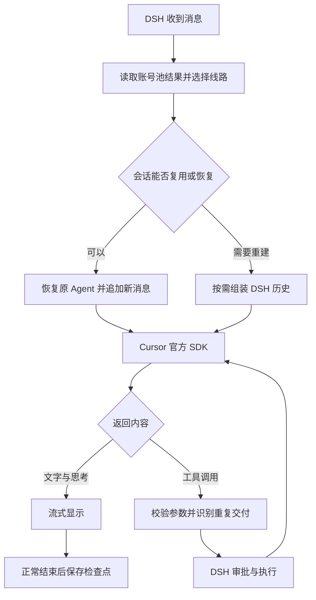

# 🧩 DSH Cursor Integration

在 DSH 中使用 Cursor 官方 SDK，把多账号调度、用量管理、会话恢复和 SSH 工具协作集中在一个插件里。

账号可以设置易读的名称，按模型类别自动选用；对话框下方直接展示用量、检查点和压缩状态。

## ✨ 亮点与设计

### 🪄 根据模型类别选账号

- **套餐额度优先**。Cursor 模型和第三方模型分别按对应额度排序，优先使用占比更低且尚未用满的账号。
- **按需额度跟随账期进度**。套餐用完后，当前账号低于今日软上限时继续使用；达到软上限后优先选用个人按需占比更低的账号。
- **手动选择随时生效**。点击对话框下方的账号名称即可切换，新请求使用选定账号；正在交还工具结果的续接使用原账号。

```text
今日软上限 = 本账期已过天数 ÷ 本账期总天数 × 100%
```

月份长度参与计算。**当前实现固定以每月 23 日为重置日**，使用其他账期的账号需要先调整调度实现。

### ⚡ 后台刷新，前台读取已有结果

账号用量、模型目录和选用结果在后台维护，消息发送读取已有快照，避免每轮都等待全账号用量查询。

- 默认每 **5 分钟**刷新，可设置为 **1～1440 分钟**。
- 启动缓存尚未就绪时沿用已保存的默认账号；缺少模型目录时仍可能发起查询。
- 同时查看 **Cursor 模型、其它模型、个人按需**，并支持查询全部账号与总体占比。
- 金额和限额完整时，总体占比按金额加权；数据不完整时显示已有比例的平均值。

### 💾 重启后恢复同一个 Agent

完整结束的轮次保存 SDK 检查点。下次打开对话时，核对账号、模型、工具配置、工作区和历史指纹，匹配后恢复原 Agent，再追加最新消息。

**完成标记在一轮结束时落盘**，文件锁控制领取，正在执行的轮次保留使用中标记。恢复遇到 429 或暂时性网络故障时，尚未发送新消息的检查点会保留，供下次重试。历史不匹配时从 DSH 历史重建。

### 🔁 同一个 SDK 工具调用只执行一次

SDK 重试或恢复连接时可能重复交付工具调用。桥接层根据 **SDK 调用 ID、工具名和参数**识别重复交付。

- 等待中的重复调用共享同一个 Promise，用户只需回答一次。
- 已完成的重复调用返回原结果，避免再次执行命令。
- 相同 ID 携带不同参数会报告冲突；不同 ID 的正常调用独立处理。

结果保留到当前 Agent 释放时清理。工具权限、审批和执行交给 DSH。

### 🌐 Cursor 专用代理与 SSH 协作

通过请求作用域处理 Cursor SDK 网络调用，覆盖 **fetch、HTTPS 和 HTTP/2**。代理匹配 `cursor.com`、`cursor.sh`、`cursorapi.com` 及其子域名，继续使用官方 SDK 端点。

提供模型线路检测和优先线路展示。SSH 工作区的项目文件和命令由远端工具处理，当前 SDK 生成的本地大段工具输出通过受路径限制的本地读取提供给模型。

### 👀 在输入区看清当前状态

- **上下文圆环**可展开系统提示词、工具定义和对话消息的本地估算。
- **检查点状态**显示恢复、复用，或重建及其原因。
- **压缩状态**读取真实事件，显示摘要进度、完成时间、失败原因及最近的工具输出裁剪时间。
- **账号与用量**支持点击切换密钥，点击用量直接进入账号池页面。

## 🏗️ 请求怎样运行



完整历史延迟到重建时才组装。普通追问尽量追加增量消息，工具续接交还已执行结果，摘要请求使用专门的提示和工具配置。

## 🚀 安装与配置

需要 Node.js **24.9 或以上**、DSH LLM 接口 **0.2.1-rc.3 或以上**，以及拥有相应模型权限的 Cursor API Key。当前 SDK 固定为 **1.0.40**。

1. 在 DSH 插件管理器中填写 `.tgz` 安装包的本机绝对路径。
2. 打开设置中的 **Cursor Integration**，保存账号名称和 API Key。
3. 获取模型目录，添加需要的型号并保存。
4. 按需设置代理地址和后台刷新间隔。

图片能力需要明确声明，未声明的型号按文字处理。确认支持图片后可在设置中启用。能力声明不会在每条消息前查询网络。

代理地址示例为 `http://127.0.0.1:7890`，端口以当前机器的 HTTP 或混合端口为准。

### 配置示例

```yaml
- id: cursor-integration
  name: dsh-cursor-integration
  config:
    proxyUrl: http://127.0.0.1:7890
    providers:
      cursor:
        apiKeyEnv: CURSOR_API_KEY
        usageRefreshMinutes: 5
        models:
          - id: your-model-id
            name: Your model
            inputModalities:
              - text
              - image
```

模型 ID 与参数以账号目录为准。`contextWindow` 单位为 Token，应填写后端实际支持的容量。密钥通过 DSH 凭据服务保存，配置中填写凭据引用。

## 🧠 上下文与压缩

Cursor SDK 管理自己的运行时、内部提示和隐藏历史。本地估算统计 DSH 可见内容，可能与 SDK usage 或原生圆环读数不同。

DSH 自动压缩由 `@deepseek-ai/dsh-compaction-basic` 管理。设置 `thresholdRatio: 0.7` 后，在约 70% 的估算压力下检查摘要需求；工具输出裁剪可能先降低压力。这个阈值在 DSH 压缩插件中配置。

SDK 没有公开硬输出 Token 上限。压缩请求的 `maxTokens` 转为提示指导，最终缩短效果由 DSH 检查。

## 🔐 本地数据与维护

数据目录为 `~/.dsh/storages/dsh-cursor-integration/`。

- **密钥**存入 DSH 凭据服务，账号配置保存引用。
- **检查点**包含对话和工具输出，应作为本地聊天数据管理。
- **清理**在启动时及每 6 小时后台执行。空闲检查点默认保留 7 天、最多 32 份，SDK 状态文件总量目标为 1 GiB。正在使用的数据跳过清理，占用可能暂时高于目标。

## 📦 从现有本地版迁移

旧包与本项目都注册 DSH 的 `cursor` 提供方，同一个 profile 应只启用其中一个。

1. 完全退出 DSH，备份 profile 配置。
2. 安装本项目，禁用旧 `cursor-provider` 条目。
3. 将旧条目 `config` 下的 `proxyUrl` 和 `providers` 内容复制到新 `cursor-integration` 条目。同机保留原 credential-ref 即可沿用已保存的密钥。
4. 新集成从 DSH 历史建立会话后，保存自己的检查点。

新机器需要自行填写密钥。账号、用量缓存、聊天和检查点由各机器本地管理。

## 🛠️ 开发与验证

```sh
npm ci --legacy-peer-deps
npm run build
npm test
npm pack
```

`package-lock.json` 锁定依赖，构建生成 DSH ModuleLoader 可加载的 `src/client.js`。

当前 **70 项回归测试已通过**，覆盖账号、图片声明、参数校验、重复调用、取消、代理、历史裁剪、摘要请求和进程直接退出后的检查点恢复。测试使用模拟 SDK；独立重写版仍需在目标 DSH 桌面版本中验证配置页和真实工具调用。

## 🧾 版本与许可证

当前版本为 **0.1.0**。源码已保存到本仓库，npm 发布与公开 Release 待桌面验收后决定。

安装包包含运行代码、bundle 配置、README 和许可证。项目使用 [MIT](LICENSE)；`@cursor/sdk`、DSH、Ajv、Zod、Undici 等依赖按各自许可证使用，浏览器 bundle 保留构建工具生成的依赖声明。
