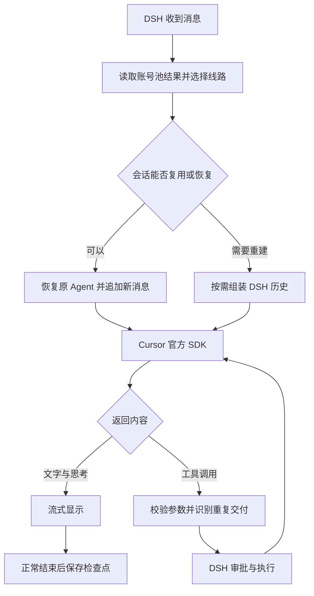

# 🧩 DSH Cursor Integration

通过 Cursor 官方 SDK 在 DSH 中使用模型，提供多账号管理、用量统计、会话恢复和 SSH 工具协作。

## 功能

- **账号池**：根据模型类别和用量选择账号，也可以在输入区手动切换。
- **用量统计**：查看每个账号的 Cursor 模型、其它模型和个人按需占比，支持批量查询和汇总。
- **会话恢复**：保存已完成轮次的检查点，重启后尝试恢复原 Agent。
- **工具调用**：由 DSH 审批和执行，对重复 SDK 调用复用原结果。
- **网络配置**：支持 Cursor 专用代理、模型线路检测和优先线路展示。
- **状态展示**：在输入区查看本地上下文估算、检查点恢复和压缩记录。

当前本地版本为 **0.1.37**。使用模拟 SDK 验证会话恢复、用量、代理及工具续接。

## 安装

需要 Node.js **24.9 或以上**、DSH LLM 接口 **0.2.1-rc.3 或以上**，以及拥有相应模型权限的 Cursor API Key。当前使用 `@cursor/sdk@1.0.40`。

1. 从 [GitHub Releases](https://github.com/qinvnb/dsh-cursor-integration/releases/latest) 下载 `.tgz` 安装包，再在 DSH 插件管理器中填写它的本机绝对路径。
2. 打开设置中的 **Cursor 集成**，保存账号名称和 API Key。
3. 展开模型目录，搜索或添加需要的模型，点击单个模型可编辑它的选项。
4. 按需填写本机 HTTP 或混合代理端口、切换流式协议（默认 HTTP/2，可选 **HTTP/1.1（SSE）**）或开启 **启用 Cursor SDK 断流自动重连（代理与直连生效）**，点击 **保存连接设置**。

「Cursor 集成 → DSH 自动压缩」可以设置原生 `thresholdRatio`（大于 0、不超过 1）。它作用于使用这套策略的模型，模型专属覆盖优先。保存需满足原生保留比例等校验，实际触发受输出预留和安全余量限制。

DSH 调用步骤、SDK 发送、新建/重建、检查点恢复及 DSH 自动重试分别统计，SDK 内部重试未观测时显示“未统计”。四类 Token 在 SDK 入口统一口径；无法确认来源和口径的旧记录单列，不计入已校准合计，原始会话文件不改写。此统计不是官方逐笔账单。

图片能力需要明确声明。未声明的型号按文字处理，确认支持图片后可在设置中启用。

## 配置

```yaml
- id: cursor-integration
  name: dsh-cursor-integration
  config:
    proxyUrl: http://127.0.0.1:7890
    providers:
      cursor:
        apiKeyEnv: CURSOR_API_KEY
        usageRefreshMinutes: 5
        models:
          - id: your-model-id
            name: Your model
            inputModalities:
              - text
              - image
```

模型 ID 与参数以账号目录为准。`contextWindow` 的单位为 Token，应填写后端实际支持的容量。API Key 存入 DSH 凭据服务，配置中填写的是凭据引用。
在「Cursor 集成 → 模型目录」选择账号后获取目录，可以查看 Cursor 公布的容量上限和可选推理档位。手动填写的容量优先用于 DSH 的上下文预算，SDK 选用满足该预算的最小可用档位。目录未提供容量时，插件会明确显示未知。

`proxyUrl` 填写 HTTP 或混合代理地址，端口以本机配置为准。代理按请求作用域处理 Cursor 域名的 fetch、HTTPS 和 HTTP/2 调用，覆盖 `cursor.com`、`cursor.sh`、`cursorapi.com` 及其子域名。

`agentHttpProtocol` 为 `http2`（默认）或 `http1`。后者使用 Cursor SDK 的 HTTP/1.1 SSE 传输，可随时切回。请求诊断会记录配置的协议，网络事件另记录实际观测的协议。

本地诊断记录保存到 `~/.dsh/storages/dsh-cursor-integration/request-diagnostics.jsonl`，滚动保留当前文件和上一份。记录包括 `Run` / `RunSSE` / `BidiAppend` 等请求和重试 ID、直连或代理线路、连接错误、白名单分类后的运行失败特征及可见响应状态，不写入 API Key、聊天正文或原始错误文本；当 `run.wait()` 或 `connect`/`send` 阶段出现未收录的新错误类别时，仅向该本地文件写入经严格脱敏（剥离 URL、路径、Token 与凭据并截断至 160 字符）的短摘要 `unrecognizedSummary`。可在插件配置中设置 `requestDiagnostics: false` 关闭。部分 SDK 内部错误只能观测到再次发起请求，原因可能仍不可见。

普通对话默认关闭 Cursor SDK 的传输自动重试，首次失败会返回给 DSH；在尚未输出内容或调用工具的初始阶段，遇到限流或鉴权失败会自动标记账号冷却（5/10 分钟）并尝试切换健康账号重试 1 次，遇到瞬时服务端或网络错会等待 1.5 秒重试 1 次（工具续接与已产出内容后绝不重放）。需要开启 SDK 内部断流自动重连时，可在设置页开启「启用 Cursor SDK 断流自动重连（代理与直连生效）」（或在插件配置设置 `proxyAgentRetries: true`），插件层会在连续重连超过 3 次或尚未建立响应前无进展超过 60 秒时自动止损（`CURSOR_RETRY_EXHAUSTED`；收到 HTTP 200 响应头后暂停 60 秒窗口计时，避免误杀健康长流）。插件同时禁用 DSH 默认的隐藏自动重试（`maxRetries: 0`），并将可恢复错误映射为 DSH 标准可继续错误码（文案保留原始内部码），在输入框下方「检查点」旁提供显式「重试」按钮与原生「继续生成」入口；手动重试时跳过空重试标记，绝不重放已完成工具。通过代理执行的上下文压缩仍启用 SDK 自动重试。

### 账号选择

Cursor 模型和第三方模型分别按对应的额度类别排序。优先使用套餐额度尚未用满、占用比例更低的账号。

套餐额度用完后，个人按需调度使用账期进度作为软上限。当前账号低于软上限时继续使用，达到后优先选择个人按需占比更低的账号。

```text
今日软上限 = 本账期已过天数 ÷ 本账期总天数 × 100%
```

月份长度参与计算。**当前实现固定以每月 23 日为重置日**，其他账期需要调整调度实现。

用量和选用结果在后台维护，默认每 5 分钟刷新，可配置为 1～1440 分钟。发送消息时读取已有快照；启动缓存尚未就绪时沿用已保存的默认账号，缺少模型目录时仍可能发起查询。

手动切换对新请求生效，工具结果续接使用原账号。总体用量在金额和限额完整时按金额加权，数据不完整时显示已有比例的平均值。

### 上下文与压缩

Cursor 会话默认隐藏 DSH 原生上下文入口，在输入区保留本地估算和占用明细。点击「圆环＋上下文＋百分比」展开浮窗；三个用量入口也可直接查看缓存明细，点击外部或按 Esc 关闭。

本地估算统计 DSH 可见的系统提示词、工具定义和对话消息。Cursor SDK 的内部提示与隐藏历史可能采用不同口径，因此本地估算可能与 SDK usage 或原生圆环读数不同。

自动压缩由 DSH 的 `@deepseek-ai/dsh-compaction-basic` 管理。例如设置 `thresholdRatio: 0.7` 后，在约 70% 的估算压力下检查摘要需求，工具输出裁剪可能先降低压力。状态行读取实际的摘要和裁剪事件。

桌面配置可将所用预设中的 `command-compact` 入口换成 `dsh-cursor-integration/manual-compaction`。这样 `/compact` 会在压缩开始后确认，沿用 DSH 的会话事件显示结果。使用 `/compact cancel` 可取消当前会话的后台手动压缩。

SDK 没有公开硬输出 Token 上限。摘要请求中的 `maxTokens` 转为提示指导，最终缩短效果由 DSH 检查。

## 工作方式

普通追问尽量复用 Agent 并追加新消息，需要重建时才组装完整历史。恢复检查点前会核对账号、模型、工具配置、工作区和历史指纹，匹配失败时从 DSH 历史重建。

一轮完成后立即保存完成标记，文件锁控制检查点领取。恢复遇到 429 或暂时性网络故障时，会保留尚未发送新消息的检查点，供下次重试。

工具桥接通过 SDK 调用 ID、工具名和参数识别重复交付。等待中的重复调用共享结果，已完成的调用返回原结果；同一 ID 携带不同参数会报告冲突。结果随当前 Agent 释放而清理，不同 ID 的调用独立处理。

工具参数校验失败时允许两次纠正；有效的工具结果交回后重新计算纠正额度，避免将长任务中已纠正的独立错误累加。连续无效参数仍会停止当前运行，已执行工具不会重放。

连接及 SDK 操作保留超时保护，流式运行按 SDK 活动重置等待时限，不再限制整轮任务必须在 30 分钟内完成。等待 DSH 工具执行期间暂停 SDK 无活动计时，工具执行时限及取消由 DSH 管理。

工具结果提交后的续接失败使用独立错误码，避免被当作普通请求超时自动重发。同一进程中短期保留失败记录，重复提交会返回原始失败类别；需要继续时，发送新的用户消息，从 DSH 已保存历史恢复，而非重用旧续接标识。该记录只保存指纹和错误类别，不是跨进程的工具执行事务保证。

在 SSH 工作区中，项目文件和命令交给远端工具。当前 SDK 运行生成的本地工具输出，通过受路径限制的本地读取提供给模型。

<details>
<summary>请求流程</summary>



</details>

## 本地数据

数据目录为 `~/.dsh/storages/dsh-cursor-integration/`。检查点包含对话和工具输出，应作为本地聊天数据管理。

启动时及每 6 小时后台清理空闲检查点，默认保留 7 天、最多 32 份，SDK 状态文件总量目标为 1 GiB。正在使用的数据跳过清理，占用可能暂时高于目标。

## 从现有本地版迁移

旧包与本项目都注册 DSH 的 `cursor` 提供方，同一个 profile 应只启用其中一个。

1. 完全退出 DSH，备份 profile 配置。
2. 安装本项目，禁用旧 `cursor-provider` 条目。
3. 将旧条目 `config` 下的 `proxyUrl` 和 `providers` 内容复制到新 `cursor-integration` 条目。同机保留原 credential-ref 即可沿用已保存的密钥。
4. 新集成从 DSH 历史建立会话后，保存自己的检查点。

新机器需要自行填写密钥。账号、用量缓存、聊天和检查点由各机器本地管理。

## 开发

```sh
npm ci --legacy-peer-deps
npm run build
npm test
npm pack
```

`package-lock.json` 锁定依赖，构建生成 DSH ModuleLoader 可加载的 `src/client.js`。

测试使用模拟 SDK，覆盖账号、图片声明、参数校验、重复调用、取消、代理、历史裁剪、摘要请求和进程直接退出后的检查点恢复。公开发布前还需在目标 DSH 桌面版本中验证配置页和真实工具调用。

## 许可证

[MIT](LICENSE)。`@cursor/sdk`、DSH、Ajv、Zod、Undici 等依赖按各自许可证使用，浏览器 bundle 保留构建工具生成的依赖声明。
